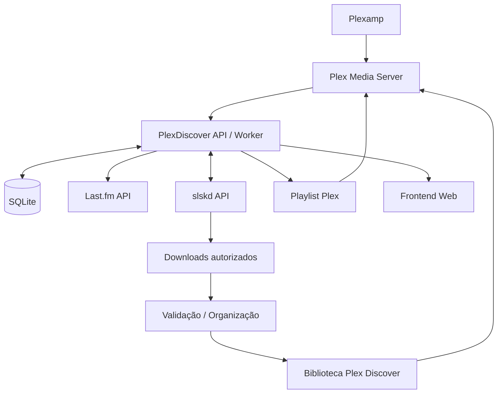

# PlexDiscover — Motor de descoberta musical para Plexamp

> **Estado:** proposta funcional e técnica (MVP + evolução)  
> **Objetivo:** descobrir artistas relacionados com a música que está a tocar, preparar uma seleção de faixas e disponibilizá-la no Plex para ouvir a seguir ao álbum atual.

## 1. Visão geral

O **PlexDiscover** é uma aplicação self-hosted que liga **Plex/Plexamp**, **Last.fm** e **slskd** para gerar playlists de descoberta musical. Enquanto o utilizador ouve um álbum no Plexamp, a aplicação identifica o artista, consulta artistas semelhantes no Last.fm, cruza-os com o histórico de audições e a biblioteca Plex, escolhe uma ou duas faixas representativas por artista, procura fontes disponíveis através do slskd e, quando existem ficheiros obtidos legitimamente, importa-os numa biblioteca de descoberta do Plex.

A playlist deve estar pronta **antes de o álbum terminar**. O modo inicial garante a playlist disponível para ser iniciada ou adicionada à fila manualmente. A passagem automática para a playlist fica sujeita à validação da capacidade de controlo da fila do cliente Plexamp em uso (iPhone, desktop, etc.).

### Princípios

- Descoberta contextual: o álbum atual define a principal referência musical.
- Personalização: o histórico Last.fm e a biblioteca Plex ajudam a distinguir novidades de artistas já conhecidos.
- Qualidade: preferência por FLAC, com fallback configurável.
- Não poluir a biblioteca principal: utilizar uma biblioteca temporária **Discover**.
- Respeitar direitos de autor e permissões: apenas importar e reproduzir ficheiros que o utilizador esteja autorizado a obter e utilizar.
- Operação autónoma e observável: tarefas assíncronas, histórico, estados, logs e recuperação de falhas.

## 2. Experiência de utilização

1. O utilizador inicia um álbum no Plexamp.
2. O PlexDiscover deteta a sessão e identifica o álbum e o artista.
3. Após confirmar que se trata de uma reprodução estável, cria uma sessão de descoberta.
4. Consulta artistas semelhantes e ordena candidatos por relevância e novidade.
5. Escolhe 1–2 músicas por artista, preferencialmente entre as mais populares no Last.fm.
6. Verifica se cada faixa já existe no Plex/Discover. Se existir, reutiliza-a.
7. Para as restantes, pesquisa no slskd e, se houver fonte autorizada, obtém o ficheiro.
8. Valida formato, duração, metadados e duplicados; importa para Discover.
9. Solicita atualização da biblioteca Plex e aguarda que os itens sejam indexados.
10. Cria/atualiza uma playlist Plex chamada, por exemplo, `Discover • Opeth • 2026-10-10`.
11. Disponibiliza a playlist antes do final do álbum e apresenta uma notificação ou indicador de prontidão.
12. Se existir suporte comprovado no cliente, pode tentar colocar a playlist a seguir na fila; caso contrário, o utilizador adiciona-a manualmente.

**Importante:** um scrobble Last.fm pode ocorrer tarde e não deve ser a única fonte de deteção da reprodução. A fonte principal será a sessão Plex; o Last.fm servirá para descoberta e histórico.

## 3. Arquitetura proposta



### Componentes

| Componente | Responsabilidade |
|---|---|
| Backend (Python/FastAPI ou Node.js) | API, integração com serviços e lógica de negócio |
| Worker assíncrono | Pesquisa, transferências, validação, importação e sincronização |
| SQLite | Sessões, candidatos, ficheiros, preferências e histórico |
| Frontend (Vue) | Agora a tocar, fila de descoberta, estado e definições |
| Plex API | Sessões, biblioteca, pesquisa de faixas, atualização e playlists |
| Last.fm API | Artistas semelhantes, top tracks e histórico autorizado |
| slskd API | Pesquisa, resultados, estado de transferências e downloads |
| Volume Discover | Área de armazenamento isolada da biblioteca principal |

Para o MVP, backend e worker podem correr no mesmo contentor, com uma fila persistente em SQLite. Evitar introduzir Redis sem necessidade.

## 4. Integrações

### 4.1 Plex / Plexamp

- Autenticar no Plex Media Server através de token configurado em segredo.
- Consultar sessões ativas (`/status/sessions`, sujeito à API disponível).
- Associar a sessão ao utilizador Plex correto e identificar o cliente Plexamp.
- Obter `ratingKey`, `grandparentRatingKey`, artista, álbum, faixa, posição e duração quando disponíveis.
- Identificar o final previsto do álbum a partir das faixas do álbum e do estado da reprodução, não apenas da duração da faixa atual.
- Pesquisar faixas já existentes na biblioteca e evitar duplicados.
- Pedir scan da biblioteca Discover e aguardar indexação dos novos itens.
- Criar/atualizar playlists na conta Plex pretendida, respeitando as permissões do utilizador.
- Investigar separadamente o controlo remoto da fila de reprodução: **não assumir** que é suportado pelo Plexamp para iOS.

### 4.2 Last.fm

Operações candidatas (confirmar parâmetros e limites na documentação atual antes da implementação):

- `artist.getSimilar` — artistas relacionados com o artista atual.
- `artist.getTopTracks` — faixas representativas de cada candidato.
- `user.getRecentTracks` — contexto das audições recentes.
- `user.getTopArtists` — familiaridade e preferências de longo prazo.
- `user.getArtistTracks` ou alternativa de histórico, quando disponível e aplicável — estimar conhecimento do artista.

A classificação de “artista novo” é **heurística**: não ter scrobbles não prova que nunca foi ouvido. Também se deve consultar a biblioteca Plex e manter uma lista explícita de artistas aceites/rejeitados.

### 4.3 slskd

- Autenticação por API key, guardada em variável de ambiente/segredo.
- Pesquisa pelo par `artista + título` e, quando necessário, pelo álbum.
- Pontuar resultados por correspondência de nome, duração, extensão, bitrate, disponibilidade e tamanho plausível.
- Evitar ficheiros suspeitos, executáveis, arquivos desnecessários e metadados inconsistentes.
- Acompanhar a conclusão e distinguir sucesso, timeout, indisponibilidade e erro.
- Limitar concorrência e aplicar retries com backoff.
- Usar exclusivamente fontes e ficheiros que o utilizador tem direito a obter.

## 5. Algoritmo de recomendação

### 5.1 Contexto

**Modo contextual (base):** artista/álbum atualmente a tocar.  
**Modo híbrido (recomendado):** 70% da relevância vem do artista atual e 30% das últimas 10–20 bandas ouvidas, para evitar resultados excessivamente repetitivos. Os pesos são configuráveis.

### 5.2 Ranking dos artistas

Pontuação inicial ilustrativa:

```
score =
    0.45 * similaridade_lastfm
  + 0.20 * afinidade_historico
  + 0.20 * novidade
  + 0.10 * diversidade
  + 0.05 * disponibilidade
  - penalizacoes
```

Normalizar as métricas entre 0 e 1. Penalizar artistas já presentes na sessão, recentemente recomendados, explicitamente rejeitados ou com excesso de scrobbles, conforme o modo escolhido.

**Não usar disponibilidade no slskd como condição para determinar relevância musical:** pode ajudar a desempatar, mas não deve distorcer a descoberta. Manter candidatos sem ficheiros disponíveis no painel, com estado próprio.

### 5.3 Escolha das faixas

- Por omissão, 5 artistas × 2 faixas = **10 faixas**.
- Escolher faixas bem classificadas no Last.fm, evitando versões ao vivo, remixes ou duplicados quando o utilizador prefere gravações de estúdio.
- Evitar repetir faixas já ouvidas/recomendadas recentemente.
- Distribuir as faixas por artistas (por exemplo, round-robin) em vez de colocar duas faixas consecutivas de cada artista, opção configurável.
- Se uma faixa não estiver disponível, tentar a seguinte do mesmo artista; nunca bloquear a playlist inteira.

## 6. Gestão de ficheiros e biblioteca

Estrutura sugerida:

```text
/discover/
  incoming/                  # downloads em validação
  music/
    Artist/
      Album/
        01 - Track.flac
  quarantine/                # ficheiros inválidos
```

Regras:

1. Os ficheiros entram primeiro em `incoming`.
2. Validar extensão real/codec com `ffprobe` e, se necessário, integridade do ficheiro.
3. Comparar duração com a referência e verificar metadados (artista, título, álbum).
4. Calcular hash e detetar duplicados; complementar com normalização de metadados.
5. Mover atomicamente para `music` após validação.
6. Fazer scan da biblioteca Plex Discover e confirmar o aparecimento da faixa.
7. Só adicionar à playlist os itens efetivamente indexados.
8. Nunca apagar uma faixa que esteja marcada como favorita, promovida para a biblioteca principal ou protegida por uma playlist que deva ser preservada.

**Retenção:** 30 dias por omissão para faixas não guardadas; limpeza configurável (7/30/90 dias/nunca). A limpeza deve mostrar previamente o que será removido e respeitar as referências ainda em uso.

## 7. Playlist e reprodução

### MVP — Fiável

- Playlist criada antecipadamente e apresentada na aplicação e no Plex.
- Indicador `Preparar → A importar → A indexar → Pronta`.
- Possibilidade de iniciar ou adicionar manualmente a playlist à fila no Plexamp.
- Sem promessas de reprodução automática não suportadas pela API.

### Evolução — Automático, se tecnicamente viável

- Investigar capacidades de controlo de reprodução por cliente e plataforma.
- Testar especificamente Plexamp iOS, Plexamp desktop e outros clientes usados.
- Confirmar se é possível acrescentar faixas à fila existente sem interromper a reprodução.
- Se suportado, acrescentar a seleção **antes** do fim do álbum, não depois.
- Garantir que não se altera uma fila que o utilizador tenha editado entretanto.
- Implementar opt-in, botão para desfazer e fallback para modo manual.

## 8. Painel web

### Página principal

- **Agora a tocar:** artista, álbum, capa, cliente e tempo estimado restante.
- **Sessão atual:** artista de referência e estado de preparação.
- **A descobrir:** candidatos, semelhança, músicas selecionadas e estado de cada uma.
- **Playlist:** número de faixas prontas, duração e link para o Plex.
- **Ações:** regenerar, ignorar artista, guardar banda, promover faixa e limpar sessão.

### Definições

| Definição | Valor inicial |
|---|---|
| Artistas por sessão | 5 |
| Faixas por artista | 2 |
| Preferência de formato | FLAC |
| Fallback | Desativado (MP3 320 kbps opcional) |
| Modo de descoberta | Apenas artistas pouco conhecidos |
| Contexto | Híbrido 70/30 |
| Retenção | 30 dias |
| Criação de playlist | Automática |
| Controlo da reprodução | Manual no MVP |
| Concorrência de transferências | 2 |
| Repetir artista recomendado | Evitar durante 30 dias |

## 9. Modelo de dados inicial

- `settings`: opções globais e por utilizador.
- `plex_users`: identificadores Plex e mapeamento para contas Last.fm.
- `playback_sessions`: cliente, utilizador, álbum, estado e timestamps.
- `discovery_sessions`: contexto, algoritmo/versão, progresso e playlist.
- `artist_candidates`: artista, pontuações, razões de recomendação e estado.
- `track_candidates`: faixa, artista, ranking e metadados de referência.
- `download_jobs`: pesquisa, resultado escolhido, estado, tentativas e erros.
- `media_files`: localização, hash, formato, qualidade e item Plex.
- `recommendation_history`: quando e porquê cada artista/faixa foi recomendado.
- `feedback`: guardar, ignorar, gostar, rejeitar, promover.

Guardar tokens apenas em variáveis de ambiente/segredos, nunca nas tabelas ou logs.

## 10. Estados e robustez

```text
DETECTED → RECOMMENDING → SEARCHING → DOWNLOADING
         → VALIDATING → IMPORTING → INDEXING → READY
```

Estados alternativos: `PARTIAL_READY`, `NO_RESULTS`, `FAILED`, `CANCELLED`, `EXPIRED`.

- Idempotência por `plexUser + album + playbackSession` para não criar sessões duplicadas em cada polling.
- Debounce para saltos rápidos entre álbuns.
- Limite de tempo de preparação e playlist parcial caso nem tudo fique pronto.
- Retentativas com backoff, limites de API e controlo de concorrência.
- Não bloquear a reprodução normal do Plexamp em caso de falha.
- Logs estruturados sem tokens, credenciais ou caminhos sensíveis desnecessários.
- Reconciliar sessões após reinício do contentor.

## 11. Segurança e rede

- Aplicação acessível apenas na rede local/VPN por omissão.
- Autenticação para o painel e autorização por utilizador Plex.
- Segredos separados para Plex, Last.fm e slskd.
- slskd pode permanecer na infraestrutura/VPN atual; o PlexDiscover comunica com a API pelo caminho de rede autorizado.
- Volumes de downloads e biblioteca com permissões mínimas necessárias.
- Não expor diretamente slskd ou a API administrativa à Internet.
- Aplicar quotas de armazenamento, downloads e tarefas simultâneas.

## 12. Docker Compose — esqueleto conceptual

> Exemplo de estrutura, **não pronto para produção**: a imagem e as variáveis definitivas serão criadas durante a implementação.

```yaml
services:
  plexdiscover:
    build: .
    container_name: plexdiscover
    restart: unless-stopped
    ports:
      - "8788:8788"
    env_file:
      - .env
    environment:
      DATABASE_PATH: /data/plexdiscover.db
      DISCOVER_ROOT: /discover
      PLEX_DISCOVER_LIBRARY: Discover
    volumes:
      - ./data:/data
      - /volume1/music-discover:/discover
    networks:
      - plexdiscover-net

networks:
  plexdiscover-net:
    driver: bridge
```

Ajustar os caminhos ao NAS Ugreen DXP2800 e à montagem **real** da biblioteca Plex. Se o Plex estiver noutro contentor, o caminho `/discover/music` no PlexDiscover tem de corresponder à pasta montada na biblioteca Discover do Plex, mesmo que o caminho interno no Plex seja diferente.

`.env` (nomes propostos):

```dotenv
PLEX_URL=http://plex:32400
PLEX_TOKEN=REPLACE_ME
LASTFM_API_KEY=REPLACE_ME
LASTFM_USERNAME=REPLACE_ME
SLSKD_URL=http://slskd:5030
SLSKD_API_KEY=REPLACE_ME
```

Não colocar chaves reais no repositório.

## 13. Plano de implementação

### Fase 1 — Prova de conceito

- Ligar à API Plex e identificar o álbum atualmente a tocar.
- Obter artistas semelhantes e top tracks no Last.fm.
- Mostrar uma lista de 5 artistas × 2 faixas no terminal ou painel simples.
- Verificar correspondências na biblioteca Plex.
- **Critério de aceitação:** recomendação contextual e sem duplicados óbvios, sem downloads.

### Fase 2 — Pesquisa e importação

- Integrar a API slskd e pesquisa de faixas.
- Implementar seleção, acompanhamento e validação dos ficheiros autorizados.
- Importar para Discover, pedir scan e resolver `ratingKey`.
- **Critério de aceitação:** faixas válidas e indexadas sem afetar a biblioteca principal.

### Fase 3 — Playlists automáticas

- Criar playlists Plex com faixas disponíveis.
- Mostrar estado em tempo real, playlist parcial e tratamento de falhas.
- Adicionar preferências, histórico e prevenção de repetições.
- **Critério de aceitação:** playlist pronta enquanto o álbum ainda toca, quando o tempo de preparação o permitir.

### Fase 4 — Experiência avançada

- Investigar e testar integração com a fila Plexamp por plataforma.
- Introduzir modo híbrido, feedback, ranking e retenção.
- Suporte multiutilizador Plex e preferências independentes.
- **Critério de aceitação:** sem interromper a reprodução nem alterar filas do utilizador inesperadamente.

## 14. Questões técnicas a validar antes de programar

1. Que APIs e permissões Plex estão disponíveis na versão do servidor e nos clientes Plexamp utilizados?
2. Como detetar de forma robusta o álbum em reprodução e estimar o tempo restante?
3. É possível adicionar itens à fila Plexamp no iPhone sem iniciar outra reprodução?
4. O Plex permite criar a playlist no contexto da conta correta (incluindo utilizadores geridos)?
5. Quais são os endpoints e formatos exatos da versão de slskd instalada?
6. Como mapear de forma segura e estável o volume Discover entre PlexDiscover e Plex?
7. Como resolver faixas com nomes ambíguos, versões diferentes ou metadados incorretos?
8. Que regras de aquisição e retenção respeitam as licenças e os direitos de utilização dos ficheiros?

## 15. Decisão recomendada

Começar com o **modo híbrido 70/30**, mas permitir alternar para 100% contextual. Construir primeiro a descoberta e a playlist, sem depender de automação da fila Plexamp. Só depois testar o controlo de reprodução no iPhone e restantes clientes.

O resultado será útil mesmo que o Plexamp não permita a transição totalmente automática: no fim do álbum, haverá uma playlist contextual pronta para ouvir, com artistas novos e faixas já organizadas.
